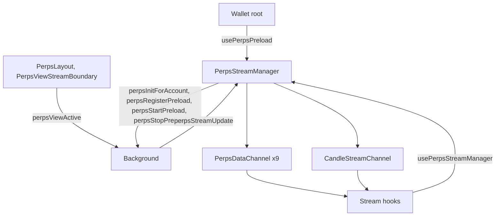

# Perps connection architecture

The Extension UI decides when to ask the background for a Perps session. The controller's `init`, `disconnect` and `reconnect` primitives are described in Core [architecture.md](https://github.com/MetaMask/core/blob/main/packages/perps-controller/docs/architecture.md#connection).

## How the UI reaches the controller

- The `PerpsController` runs in the background. The UI holds no controller instance; it sends requests with `submitRequestToBackground` and receives `perpsStreamUpdate` notifications.
- `connectToBackground` passes each `perpsStreamUpdate` to `PerpsStreamManager.handleBackgroundUpdate`, except the `lifecycleContext` `warm` signal.
- Controller state reaches the UI through Redux `state.metamask` (`activeProvider`, `isTestnet`, `cachedMarketDataByProvider`, `cachedUserDataByProvider`).
- `getPerpsController`, `PerpsControllerProvider` and `usePerpsController` in the providers index are mocks. Nothing outside `ui/providers/perps/` imports them.
- The background request handlers, the stream bridge and the controller wiring are not checked here (outside the sparse checkout).

Code: `ui/index.js` `connectToBackground`; `ui/providers/perps/PerpsStreamManager.ts` `init`, `handleBackgroundUpdate`; `ui/providers/perps/index.ts`; `ui/providers/perps/getPerpsController.mock.ts` `getPerpsController`; `ui/pages/perps/perps-layout.tsx` `PerpsControllerCacheSnapshot`.

## Who sends lifecycle requests

| Caller                                                                | Request                                                                                                                         | When                                                                                                                                                         |
| --------------------------------------------------------------------- | ------------------------------------------------------------------------------------------------------------------------------- | ------------------------------------------------------------------------------------------------------------------------------------------------------------ |
| `usePerpsPreload` through `PerpsStreamManager.startPreload`           | `perpsRegisterPreload`, then `perpsInitForAccount` (skipped when already initialised for the address), then `perpsStartPreload` | Wallet ready, Perps available, Basic Functionality on, an EVM address selected. Runs again when address, provider, network or Terminal backend flag changes. |
| `usePerpsPreload` session `stop`                                      | `perpsStopPreload(id, preserveConnection)`                                                                                      | Effect cleanup. `preserveConnection` is true after a successful preload, which leaves teardown to the background grace period.                               |
| `usePerpsStreamManager` through `initForAddress`                      | `perpsInitForAccount(address)`                                                                                                  | Stream hook mount, and address, provider or network change. Sends nothing when the manager is already initialised for the address.                           |
| `PerpsLayout`, `PerpsViewStreamBoundary` through `usePerpsViewActive` | `perpsViewActive(true)`, then `perpsViewActive(false)`                                                                          | Mount and unmount. `PerpsViewStreamBoundary` wraps `PerpsView` in the Perps tab.                                                                             |
| `PerpsTab`                                                            | `perpsDisconnect`                                                                                                               | Basic Functionality is off.                                                                                                                                  |
| `PerpsLayout`                                                         | `perpsCheckHealth`                                                                                                              | The page becomes visible, unless it was hidden for less than 30 s.                                                                                           |

- `initForAddress` returns at once when ready for the address and shares a pending init for the same address. Otherwise it resets the channels, keeps mounted candle subscribers, and queues behind the previous init so an A, B, A switch cannot finish out of order. A failed init resets the manager and rethrows.
- While an init is pending, `handleBackgroundUpdate` drops updates until an `accountSession` update for the new address arrives.
- `startPreload` times out after 30 s (`CONNECTION_TIMEOUT_MS`). It traces `PerpsConnectionEstablishment`, or `PerpsAccountSwitchReconnection` on an account change. On success it prewarms the channels.
- The caller of `usePerpsPreload` is outside the sparse checkout. Its trace tags name the source `wallet_root`.

Code: `ui/hooks/perps/usePerpsPreload.ts` `usePerpsPreload`; `ui/providers/perps/PerpsStreamManager.ts` `startPreload`, `initForAddress`, `handleBackgroundUpdate`; `ui/hooks/perps/stream/usePerpsStreamManager.ts` `usePerpsStreamManager`; `ui/hooks/perps/stream/usePerpsViewActive.ts` `usePerpsViewActive`; `ui/components/app/perps/perps-view-stream-boundary.tsx` `PerpsViewStreamBoundary`; `ui/components/app/perps/perps-tab.tsx` `PerpsTab`; `ui/pages/perps/perps-layout.tsx` `PerpsLayout`.

## Popup, side panel and full screen

- Only modal layouts branch on the UI surface (slippage, candle period, order book config, tutorial). The popup, side panel and full-screen page mount the same hooks.
- `PerpsStreamManager` is a module-level singleton shared by every Perps view in a UI. The background coordinator serialises provider teardown and activation across windows (outside the sparse checkout).
- A popup close ends the page before React cleanup runs. `perpsViewActive(false)` can then fail, and the last Perps route stays persisted for the next open.
- On a cold mount `PerpsLayout` seeds the channels from the controller caches in Redux, in a layout effect. Markets are skipped while the Terminal backend is on. User channels load only when the cached address matches the selected account. Positions load as a seed, so the REST fallback still confirms them.
- `usePerpsLifecycleBreadcrumbs` adds Sentry breadcrumbs when the popup opens, hides, shows and closes.

Code: `ui/pages/perps/perps-layout.tsx` `PerpsLayout`; `ui/providers/perps/PerpsStreamManager.ts` `getPerpsStreamManager`, `hydrateFromControllerCache`; `ui/hooks/perps/stream/usePerpsViewActive.ts`; `ui/hooks/perps/usePerpsLifecycleBreadcrumbs.ts` `usePerpsLifecycleBreadcrumbs`.

## PerpsStreamManager channels

| Channel                                            | Fed by                                               | Fallback                                                                                              |
| -------------------------------------------------- | ---------------------------------------------------- | ----------------------------------------------------------------------------------------------------- |
| `positions`                                        | Background push, with optimistic TP/SL applied       | `perpsGetPositions` after 3 s with no live data                                                       |
| `orders`                                           | Background push                                      | `perpsGetOpenOrders` after 3 s with no cache                                                          |
| `account`                                          | Background push                                      | `perpsGetAccountState` after 3 s with no cache. A failed fetch pushes nothing, so the skeleton stays. |
| `markets`                                          | Background push                                      | `perpsGetMarketDataWithPrices` with `useTerminalApi` after 3 s with no cache                          |
| `prices`                                           | Background push, merged by symbol                    | None                                                                                                  |
| `orderBook`                                        | Background push                                      | None                                                                                                  |
| `orderBookAggregated`, `orderBookAggregatedStatus` | Background push for the active `subscriptionId` only | None                                                                                                  |
| `fills`                                            | Background push                                      | None                                                                                                  |
| `candles`                                          | `CandleStreamChannel`                                | None                                                                                                  |

- `prewarm` holds subscriptions on `positions`, `orders`, `account`, `markets`, `prices` and `orderBook`. `cleanupPrewarm` drops them and keeps the cache.
- An optimistic TP/SL override lasts 30 s. Stream position pushes are held for 3 s after an optimistic update, then the latest one applies.
- `setUseTerminalApi` clears the markets cache when the flag changes.

### PerpsDataChannel

- `subscribe` calls back at once with the cache, connects on the first subscriber and disconnects on the last unless prewarming. The cache stays.
- `hasCachedData` compares the cache with the initial value by reference.
- `clearCache` bumps a generation. Only the positions REST paths drop replies from an older generation; the orders, account and markets fallbacks do not check it.
- `reset` disconnects, clears the cache and stops prewarm.

### CandleStreamChannel

- One entry per `${symbol}-${interval}`. The first subscriber sends `perpsActivateCandleStream`; the last unsubscribe sends `perpsDeactivateCandleStream` for that key.
- A connect within 120 ms of the last disconnect waits out the rest of that window, which stays inside the bridge's 150 ms teardown defer.
- Each subscriber has its own throttle; the first delivery is immediate.
- `fetchHistoricalCandles` loads 50 to 500 older candles through `perpsFetchHistoricalCandles` and keeps the newest 1000.
- `reconnect` re-activates keys that have subscribers. It has no production caller.

Code: `ui/providers/perps/PerpsStreamManager.ts` `PerpsStreamManager`, `prewarm`, `cleanupPrewarm`, `setOptimisticTPSL`, `setUseTerminalApi`; `ui/providers/perps/PerpsDataChannel.ts` `PerpsDataChannel`; `ui/providers/perps/CandleStreamChannel.ts` `CandleStreamChannel`.

## perps-cache.ts

| Cache       | Request                                 | TTL   | Key                                                     |
| ----------- | --------------------------------------- | ----- | ------------------------------------------------------- |
| Market info | `perpsGetMarkets` with `useTerminalApi` | 5 min | `provider:network:address`, plus `terminal` or `direct` |
| Order fills | `perpsGetOrderFills` from 90 days back  | 30 s  | `provider:network:address`                              |

- Both share one in-flight request per key. A failed request resolves to an empty list and caches nothing.
- `usePerpsMarketInfo` and `usePerpsMarketFills` read them, keyed by `usePerpsCacheKey`.
- `PerpsStreamManager` clears both on an address change, `clearAllCaches` and `reset`.

Code: `ui/providers/perps/perps-cache.ts` `buildPerpsCacheKey`, `fetchMarketInfos`, `fetchFillsForCacheKey`, `clearPerpsMarketInfoModuleCache`, `clearPerpsMarketFillsModuleCache`; `ui/hooks/perps/usePerpsCacheKey.ts`.

## Subscription cleanup

| Piece                   | Subscribes                                                                 | Cleans up                                                                                               |
| ----------------------- | -------------------------------------------------------------------------- | ------------------------------------------------------------------------------------------------------- |
| `usePerpsChannel`       | `channel.subscribe`                                                        | Unsubscribes in the effect cleanup. A new `resetKey` clears the channel cache.                          |
| `usePerpsLiveCandles`   | `candles.subscribe`                                                        | Unsubscribes in the effect cleanup                                                                      |
| `usePerpsLivePrices`    | `perpsActivatePriceStream`                                                 | `perpsDeactivatePriceStream` with no arguments                                                          |
| `usePerpsLiveOrderBook` | `perpsActivateOrderBookStream` or `perpsActivateOrderBookAggregatedStream` | Matching deactivate with no arguments. The aggregated path also clears its `subscriptionId` and caches. |
| `usePerpsTopOfBook`     | `perpsActivateOrderBookStream`                                             | `perpsDeactivateOrderBookStream` with no arguments                                                      |
| `usePerpsPreload`       | Preload session                                                            | `stop`, and `clearAllCaches` on unmount or when enabled, address, provider or network changes           |

- The price stream is one shared background stream. Its hook comment says this is safe while one owner is active at a time.
- The background `subscribeTo*` calls are not checked here (outside the sparse checkout).

Code: `ui/hooks/perps/stream/usePerpsChannel.ts`; `ui/hooks/perps/stream/usePerpsLiveCandles.ts`; `ui/hooks/perps/stream/usePerpsLivePrices.ts`; `ui/hooks/perps/stream/usePerpsLiveOrderBook.ts`; `ui/hooks/perps/stream/usePerpsTopOfBook.ts`; `ui/hooks/perps/usePerpsPreload.ts`.

## Against the client contract

Rules from Core [What a client must do](https://github.com/MetaMask/core/blob/main/packages/perps-controller/docs/architecture.md#what-a-client-must-do).

| Core rule                                                       | Extension piece                                                     | Status | Reason                                                                                                                                                                                                                                                                      |
| --------------------------------------------------------------- | ------------------------------------------------------------------- | ------ | --------------------------------------------------------------------------------------------------------------------------------------------------------------------------------------------------------------------------------------------------------------------------- |
| One owner decides when to call `init` and `disconnect`          | `PerpsStreamManager` (`startPreload`, `initForAddress`); `PerpsTab` | Gap    | Init requests go through `PerpsStreamManager`, but `PerpsTab` sends `perpsDisconnect` on its own. The background owner of the controller calls is not checked.                                                                                                              |
| Use the `PERPS_CONSTANTS` timings                               | `PerpsStreamManager` `CONNECTION_TIMEOUT_MS`                        | Gap    | The preload timeout is a local `30_000`, not `ConnectionAttemptTimeoutMs`. The grace period lives in the background and is not checked.                                                                                                                                     |
| On account change, reconnect if the new account needs live data | `usePerpsPreload`, `usePerpsStreamManager`                          | Met    | An address change stops the old preload and sends `perpsInitForAccount` for the new address. Channels and module caches reset.                                                                                                                                              |
| Show loading or failed while not ready; make no data calls      | `usePerpsStreamManager`, `usePerpsChannel`                          | Gap    | Nothing in the perps folders reads `initializationState`. After a failed init `usePerpsChannel` stays loading; only `usePerpsPositionForAsset` reads the error. `usePerpsMarketInfo`, `usePerpsMarketFills` and `usePerpsTopOfBook` send requests without waiting for init. |
| Keep every unsubscribe and call it on teardown                  | Stream hooks, `PerpsDataChannel`, `CandleStreamChannel`             | Met    | Every UI subscribe and stream activation has a cleanup, in its effect or through `useSyncExternalStore`. Price and order-book deactivates carry no owner.                                                                                                                   |
